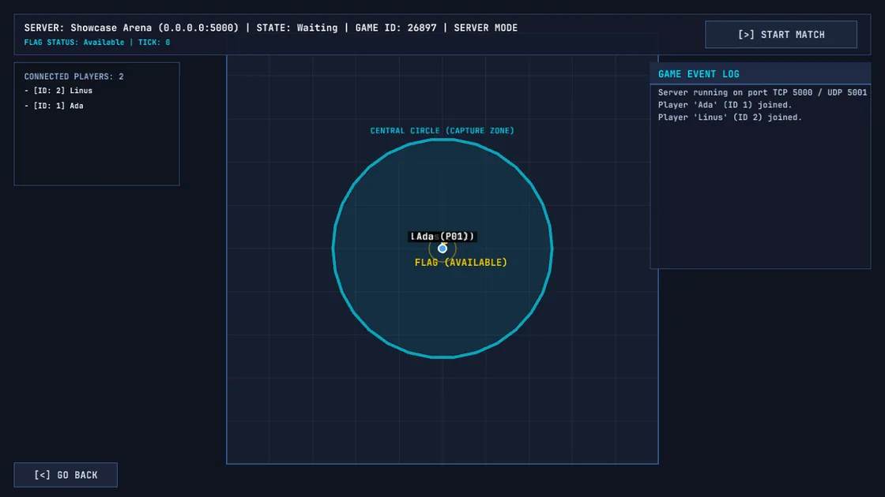
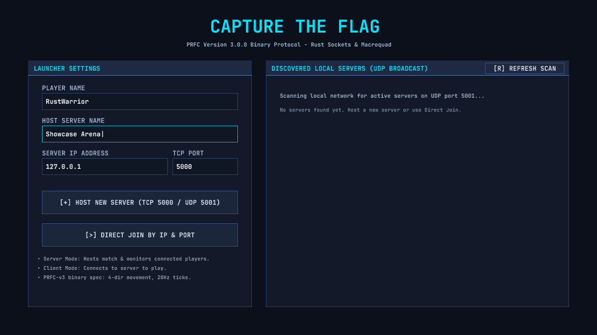
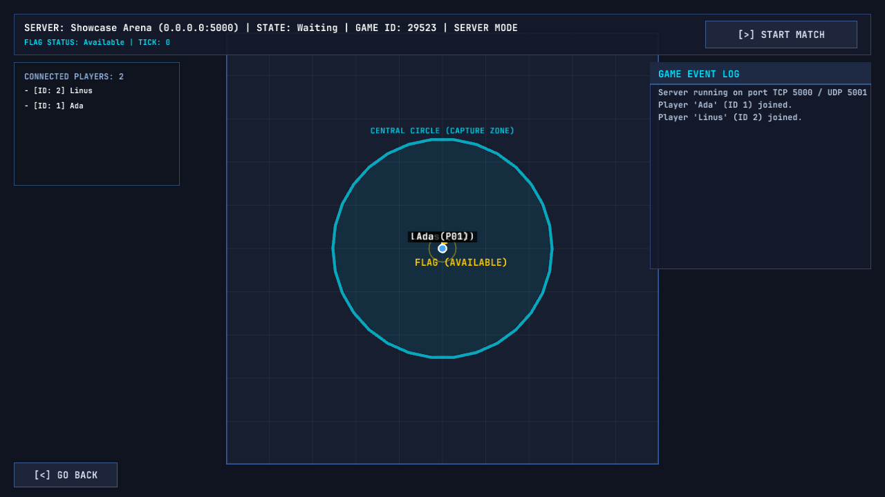
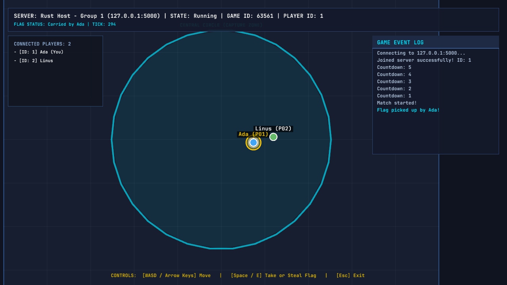
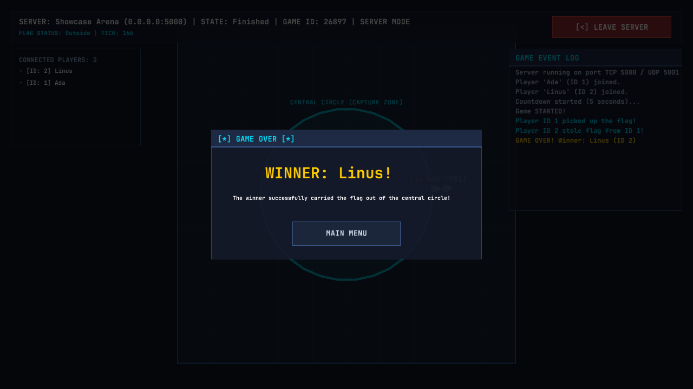
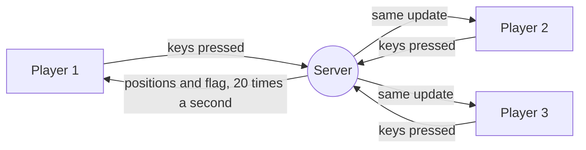

<h1 align="center">Capture the Flag</h1>

<p align="center">
  <strong>A real-time multiplayer arena game for the local network, written in Rust.</strong><br>
  Grab the flag in the middle, carry it out of the circle, and don't let anyone steal it on the way.
</p>

<p align="center">
  
</p>

<p align="center">
  <sub>A full round, seen from the host's window: Ada grabs the flag, Linus steals it and breaks out of the circle to win.</sub>
</p>

<p align="center">
  <a href="#quick-start">Quick start</a> ·
  <a href="#how-to-play">How to play</a> ·
  <a href="#screenshots">Screenshots</a> ·
  <a href="#how-it-works">How it works</a>
</p>

---

## Highlights

- **One app, two roles.** The same program hosts a match or joins one. Open it on several machines, or several times on one, and play.
- **Finds games on its own.** Servers on the local network show up in the launcher automatically; you can also join by IP address.
- **The server is the referee.** Players only send what they press. The server moves everyone, settles every grab and steal, and decides who wins, so nobody can cheat by editing their own copy.
- **Plays with other teams' games.** Every team in the course built its own version from the same shared rulebook, down to the exact bytes of each message, so a player on this game can join a server written by another team in another language, and the other way around.
- **Fast and light.** 20 updates a second, with a whole two-player game state fitting in about 50 bytes.
- **Every message on record.** Each session writes a log of everything sent and received, to see exactly what happened in a match.

---

## Screenshots

<table>
  <tr>
    <td width="50%" valign="top">
      
      <br><sub><b>Launcher.</b> Pick a name, then host a match or join one from the list of servers found on the network.</sub>
    </td>
    <td width="50%" valign="top">
      
      <br><sub><b>Lobby.</b> The host sees who has joined and starts the match when everyone is in.</sub>
    </td>
  </tr>
  <tr>
    <td valign="top">
      
      <br><sub><b>A player's view.</b> The camera follows you. Here Ada has the flag and Linus is right on her.</sub>
    </td>
    <td valign="top">
      
      <br><sub><b>Game over.</b> The first player to carry the flag out of the circle wins.</sub>
    </td>
  </tr>
</table>

---

## How to play

1. Everyone starts just outside the central circle, at a random spot.
2. Run to the flag in the middle and press **Space** (or **E**) to grab it.
3. Carry it out of the circle to win.
4. Anyone within reach of the carrier can press **Space** to steal the flag instantly. There's no cooldown, so it can change hands many times in a few seconds.

| Key | Action |
| :--- | :--- |
| **W A S D** or **arrow keys** | Move (up, down, left, right) |
| **Space** or **E** | Grab or steal the flag |
| **Esc** | Leave the match |

---

## Quick start

You need [Rust](https://rustup.rs/) 1.85 or newer. Then, from the project folder:

```bash
cargo run --release
```

Start it from the project folder, since the game loads its font from `assets/`.

- **To host:** type a server name and click **Host new server**. The host's window shows the whole map and runs the match; click **Start match** once everyone has joined.
- **To play:** open the game again (on this computer or another one on the same network), type your name, and pick the server from the list on the right, or enter its IP address and click **Direct join**.

The game uses TCP port **5000** for the match and UDP port **5001** to find servers, so allow both through the firewall when playing across machines.

---

## How it works



Players never move themselves. Each window only tells the server which direction is held and when Space is pressed. Twenty times a second the server moves everyone, checks who is close enough to grab or steal the flag, checks whether the carrier has left the circle, and sends the new state to every player. If two players try to steal on the same update, the lower player number wins, so every team's server settles a tie the same way.

To find a game, the launcher sends a broadcast on the local network, and every server still in its lobby answers with its name and how many players it has.

The rules and the exact message format come from the course's shared protocol, [`PRFC-VERSION-3.md`](PRFC-VERSION-3.md) (in Spanish; all versions are in [erickm13/CC8-Protocolo](https://github.com/erickm13/CC8-Protocolo)).

---

## Project structure

```
src/
├── app/        # launcher, host and player screens
├── server/     # the referee: game rules, updates and connections
├── client/     # connects to a server, sends keys, receives updates
├── protocol/   # message format shared by both sides
├── gui/        # drawing the map, players, camera and overlays
├── debugger/   # writes every message to logs/
└── config.rs   # colours, sizes and other settings
```

Logs are written to `logs/server-<time>.log` and `logs/client-<time>.log`.

---

## Credits

Made by [@GabGP](https://github.com/GabGP) and [@guillermo-martinez42](https://github.com/guillermo-martinez42) for the course CC8. Built with [macroquad](https://macroquad.rs/). Font: [JetBrains Mono](https://www.jetbrains.com/lp/mono/), under the SIL Open Font License (see `assets/fonts/OFL.txt`).

Released under the [MIT License](LICENSE).
